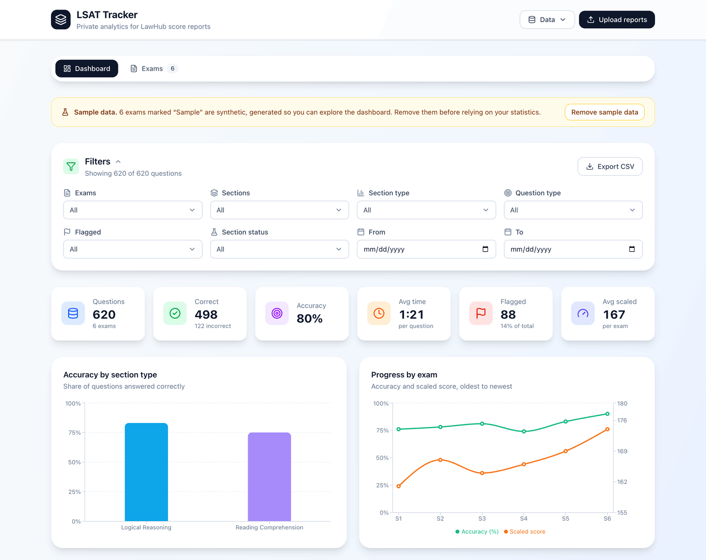
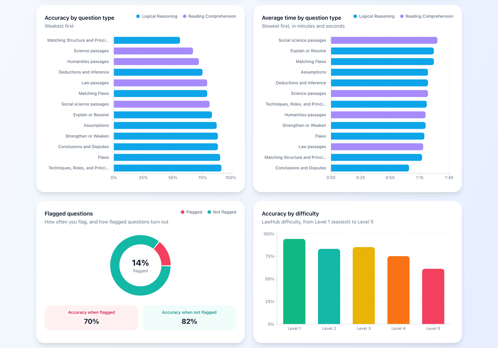
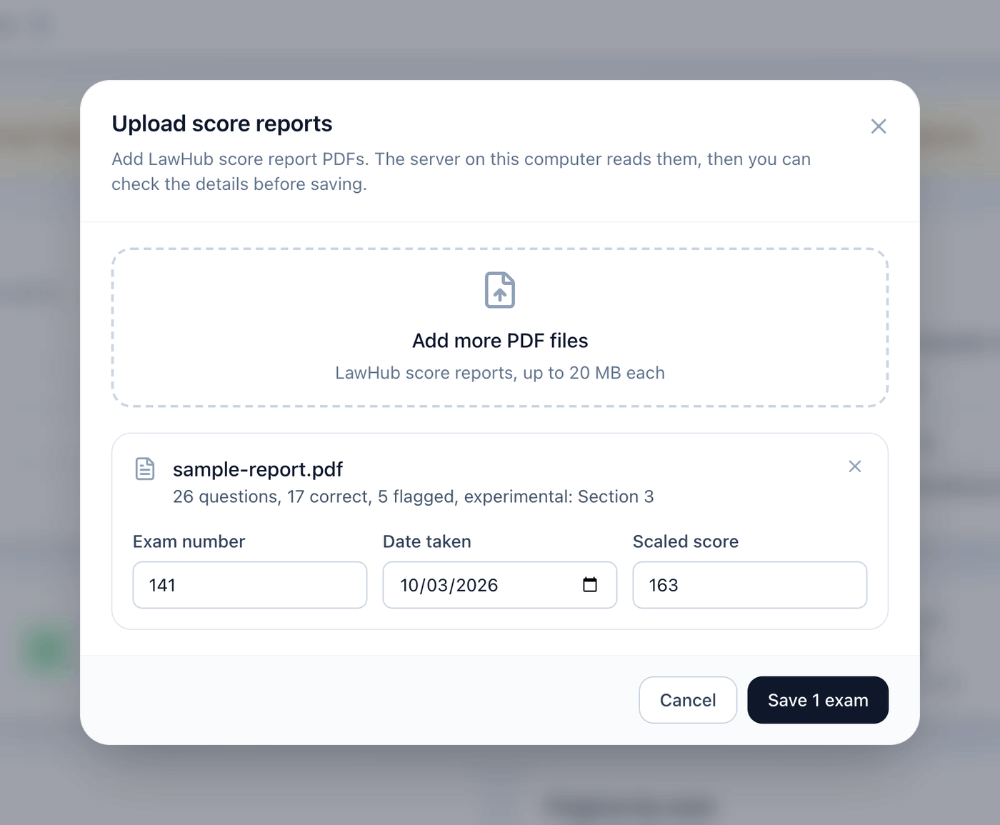
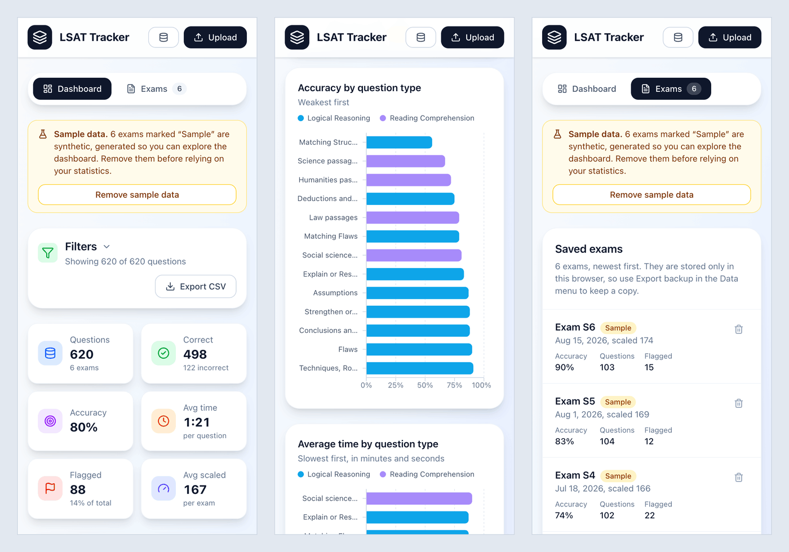
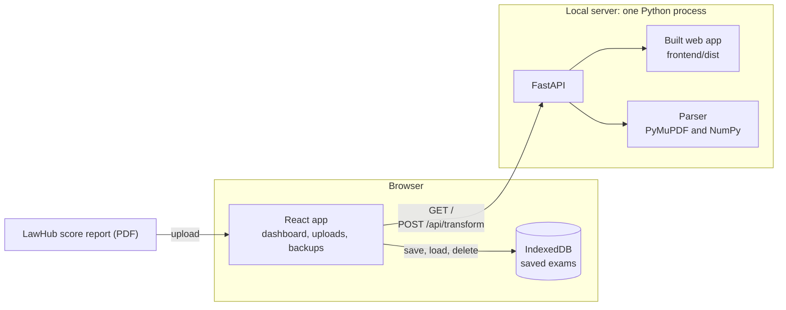

# LSAT Tracker

[](https://github.com/Bakar404/lsat-tracker/actions/workflows/ci.yml)

LSAT Tracker turns LawHub score reports into a private analytics dashboard. Upload the PDF score report of each LSAT practice test to see which question types, difficulty levels and sections cost you points, how long each kind of question takes you, and how your accuracy and scaled score change from test to test.

Everything runs on your computer. One command starts a local server, reports are parsed in memory, and the results are stored in your browser. There is no account, no cloud service and no tracking.



## Features

- **Score report import.** Upload one or more LawHub score-report PDFs at once. Each report becomes one row per question (section, question number, type, difficulty, time, result, flag and experimental section). Before saving, you review the exam number, date and scaled score the app detected.
- **Dashboard.** Summary cards for questions, accuracy, average time per question, flagged questions and average scaled score. Charts show accuracy by section type, progress by exam, accuracy and average time by question type, how flagged questions turn out, and accuracy by difficulty.
- **Filters and drill-down.** Filter by exam, section, section type, question type, flag, scored or experimental section, and date range. Every matching question appears in a sortable table and can be exported as CSV.
- **Exam management.** List saved exams with their accuracy, question count and flags, and delete the ones you no longer need.
- **Backup and export.** Export all data as a JSON backup and import it in another browser or on another computer, or export every question as CSV for a spreadsheet.
- **Sample data.** Six clearly labelled synthetic exams let you explore the dashboard before you upload a report. One click removes them.
- **Phone and desktop layouts.** Every view adapts to the screen size, and charts skip their animations when the system asks for reduced motion.

### Screenshots

Accuracy and time by question type, flagged questions and accuracy by difficulty:



Reviewing a parsed report before saving it:



On a phone:



## Quick start

You need:

- Python 3.11 or newer
- Node.js 22.13 or newer, with npm
- make (included with the macOS command line tools and most Linux distributions; see [Without make](#without-make) otherwise)

```sh
git clone https://github.com/Bakar404/lsat-tracker.git
cd lsat-tracker
make run
```

Then open <http://127.0.0.1:8613>. The first run creates a virtual environment in `backend/.venv`, installs the pinned Python and npm dependencies, builds the web app and starts the server. This usually takes a minute or two. Later runs reuse the installed dependencies. Press Ctrl+C to stop the server.

No score report at hand? Choose **Explore with sample data** on the welcome screen. To try an upload, run `make sample-pdf`, which writes a synthetic report to `sample-report.pdf`.

These make variables change the defaults:

| Variable | Default | Purpose |
| --- | --- | --- |
| `PORT` | `8613` | Port of the app, for example `make run PORT=9000` |
| `HOST` | `127.0.0.1` | Interface to listen on. The default accepts connections from this computer only. |
| `WEB_PORT` | `5183` | Port of the Vite dev server started by `make dev` |
| `PYTHON` | first Python 3.11+ on `PATH` | Interpreter for the virtual environment, for example `make run PYTHON=python3.12` |

### Without make

macOS and Linux:

```sh
python3 -m venv backend/.venv
backend/.venv/bin/python -m pip install -r backend/requirements.txt
npm --prefix frontend ci
npm --prefix frontend run build
cd backend && .venv/bin/python -m lsat_tracker serve
```

Windows (PowerShell):

```powershell
# Any installed Python 3.11 or newer works; `py --list` shows them.
py -3.12 -m venv backend\.venv
backend\.venv\Scripts\python -m pip install -r backend\requirements.txt
npm --prefix frontend ci
npm --prefix frontend run build
cd backend
.venv\Scripts\python -m lsat_tracker serve
```

`serve` accepts `--host` and `--port`. Run it with `--help` to see every option.

## Getting your score report as a PDF

LSAT Tracker reads the detailed score report that LawHub shows for a completed practice test, which lists every question with its response, subtype, difficulty and time.

1. Sign in to LawHub and open the score report of a completed test.
2. Open the detailed view with the question table. Its header reads `# Response Subtype Difficulty Total Question Time`.
3. Save the whole report, with every section, as a PDF. Use the report's download option if it has one. Otherwise print the page from your browser and choose **Save as PDF** as the destination. Turn on the print option for background graphics (called Background graphics or Print backgrounds, depending on the browser) so the coloured answer markers are kept.
4. Upload the PDF in LSAT Tracker. Check the detected exam number, date and scaled score, fill in anything that is missing, and save.

The exam number and date are read from the PDF title or the file name. A file named `PrepTest 141 2026-10-03.pdf` is recognized as exam 141, taken on 3 October 2026.

## How parsing works

The score report marks each answer as right or wrong with a coloured graphic, a teal check or an orange cross, rather than with text, so extracting the text is not enough. The parser (`backend/lsat_tracker/parser.py`) combines two signals on every page:

1. **Text extraction.** PyMuPDF returns every text span with its position. Spans are grouped into visual lines, and each line is matched against the row pattern: question number, answer letter, subtype, `Level N` and the time spent (`1m 05s`, `45s`, `2m` or `1:05`). The table header locates the Response column, and each row keeps its vertical position on the page.
2. **Colour sampling.** The page is rendered at 300 dpi, which turns a US Letter page into a 2550 by 3300 pixel image, and sampled at each row's position. The mean colour of the non-white pixels in the middle of the response cell is classified as teal (correct) or orange (incorrect) by comparing the red channel with green and blue. A band between the question number and the Response column is scanned for blue-gray pixels: when they cover more than 0.2% of the band, the question is flagged.

The rest of the report supplies the context:

- A `Section N` heading assigns a page's rows to their section, and `Section N (*)` marks the unscored experimental section.
- `Scaled Score: NNN` on the first page gives the scaled score.
- The exam number and date come from the PDF title or the file name. The parser takes the last date it finds (`MM/DD/YYYY`, `YYYY-MM-DD` or `Month D, YYYY`; numeric dates may use `/`, `-` or `_`) and the number just before it.

Each question becomes a record like this one:

```json
{
  "section": 1,
  "question": 3,
  "subtype": "Flaws",
  "difficulty": 3,
  "total_time_seconds": 120,
  "question_score": 0,
  "flagged": true,
  "experimental_section": false
}
```

The coordinates and colour thresholds were calibrated on real LawHub reports. The test suite checks them against synthetic reports that reproduce the same layout (see [Tests](#tests)).

The parser also works from the command line:

```sh
cd backend
.venv/bin/python -m lsat_tracker parse ../sample-report.pdf --json
```

Without `--json`, it writes two CSV files, one row per question and the exam metadata, to `output_csvs/` in the current directory, or to the directory given with `--out`.

## Privacy

- The web app and the parser run on your computer. An uploaded report goes only to the local server, which parses it and discards it right away. Reports are never stored or sent anywhere else.
- Parsed results are stored in your browser's IndexedDB, in the browser profile you use to open the app. The app has no accounts, cookies, analytics or third-party requests.
- Clearing the browser's site data deletes your exams. Use **Data > Export backup (JSON)** to keep a copy or to move your data to another browser.

The server checks every upload (file extension, content type, PDF signature, a 20 MB size limit and a 100-page limit) and parses one report at a time. It listens on 127.0.0.1 by default. CSV exports prefix cells that a spreadsheet would run as formulas.

## Architecture



- One Python process serves both the API and the built web app, so the whole product runs on a single port. The web app calls the API with relative `/api` URLs.
- In development, `make dev` runs the API with auto-reload next to the Vite dev server, which hot-reloads the web app and proxies `/api` to the API.
- The server keeps no state between requests. The browser stores exams in IndexedDB keyed by exam number, so saving a report for an exam you already have replaces it. The upload review warns you before that happens.

### API

| Method | Path | Description |
| --- | --- | --- |
| `GET` | `/api/health` | Health check: `{"status": "ok", "version": "1.0.0"}` |
| `POST` | `/api/transform` | Parses a score report. Multipart form with `file` (a PDF of up to 20 MB and 100 pages) and optional `exam_number` and `exam_date` (`YYYY-MM-DD`) overrides. Returns `filename`, `metadata` and `rows`. |
| `GET` | `/api/docs` | Interactive OpenAPI reference |

```sh
curl -F "file=@sample-report.pdf;type=application/pdf" http://127.0.0.1:8613/api/transform
```

Errors return `{"detail": "..."}` with a message meant for the user:

- 400 for an empty file;
- 413 for a file over the size limit;
- 415 for anything that is not a PDF;
- 422 for a PDF that cannot be read or has no question table, or for an invalid override.

## Tech stack

| Layer | Tools |
| --- | --- |
| Web app | React 19, Vite 8, Tailwind CSS 4, Recharts, lucide-react, idb-keyval |
| Server | Python 3.11+, FastAPI, Uvicorn |
| PDF parsing | PyMuPDF, NumPy |
| Quality | pytest, Ruff, Vitest, ESLint, GitHub Actions |

## Development

```sh
make dev          # API on :8613 with auto-reload, web app on http://localhost:5183 with hot reload
make test         # backend and frontend test suites
make lint         # Ruff (lint and format check) and ESLint
make check        # lint, tests and a production build: the same checks as CI
make sample-pdf   # write a synthetic score report to sample-report.pdf
make clean        # remove the virtual environment, node_modules and build output
make help         # list every target
```

See [CONTRIBUTING.md](CONTRIBUTING.md) for conventions and a manual test checklist.

### Tests

- **Parser** (`backend/tests/test_parser.py`). Each test builds its own report with PyMuPDF using `backend/tests/synthetic_report.py`. The generated report has:
  - the table header and question rows;
  - teal and orange response strips;
  - blue-gray flag marks;
  - a `Section N (*)` experimental section;
  - the scaled score on page 1;
  - the exam number and date in the PDF title.

  The tests check every parsed row, correct and incorrect answers, flags, the experimental section and the metadata. They also cover time and date formats, file name fallbacks, password-protected and unreadable files, and the page limit.
- **API** (`backend/tests/test_api.py`). FastAPI's `TestClient` covers:
  - a successful upload, with and without overrides;
  - every error response: wrong file type, empty file, file too large, not a PDF, unreadable PDF, no question table and invalid date;
  - serving the web app.
- **Web app** (`frontend/src/lib/*.test.js`). Vitest covers the analytics aggregations and filters, backup validation and round trips, CSV export, the sample data generator and API error handling.

CI (`.github/workflows/ci.yml`) runs on every push and pull request. It runs the backend checks on Python 3.11 and 3.14 and the frontend checks on Node.js 22 and 24.

## Project structure

```text
lsat-tracker/
├── Makefile                    setup, run, dev, test and lint tasks
├── backend/
│   ├── lsat_tracker/
│   │   ├── parser.py           PDF parsing: text extraction and colour sampling
│   │   ├── api.py              FastAPI app: /api routes and the built web app
│   │   └── __main__.py         command line: serve and parse
│   ├── tests/                  pytest suites and the synthetic report generator
│   ├── requirements.txt        pinned runtime dependencies
│   └── requirements-dev.txt    pinned test and lint tools
├── frontend/
│   ├── src/
│   │   ├── components/         dashboard, charts, upload dialog, exam list
│   │   ├── hooks/              exam state, hash routing, media queries
│   │   └── lib/                analytics, storage, backup, API client, sample data
│   └── vite.config.js          build settings and the /api dev proxy
├── screenshots/                images used in this README
└── .github/workflows/ci.yml    lint, test and build on every push and pull request
```

## Troubleshooting

- **The port is already in use.** Start on another port, for example `make run PORT=8614`.
- **make says Python 3.11 or newer is required.** Install a current Python from python.org or your package manager, or point make at one: `make run PYTHON=/path/to/python3.12`.
- **npm warns about an unsupported engine.** Install Node.js 22.13 or newer.
- **The browser says the web app has not been built.** Run `make run`, or `npm --prefix frontend run build`, then reload the page.
- **An upload says no question rows were found.** Upload the detailed score report with the question table, saved as a PDF from LawHub rather than a scan or a screenshot.

## Limitations

- The parser depends on the layout and colours of LawHub score reports. Its coordinates and thresholds were calibrated on real reports, while the tests in this repository use synthetic reports that reproduce that layout. If LawHub changes its report design, parsing can fail or misread answers, so compare your first results with LawHub.
- The PDF must contain real text and keep the coloured answer markers. Scanned or image-only PDFs cannot be read, and a PDF printed without background graphics may lose the colours that mark right and wrong answers.
- Each page with questions must name its section (`Section N`). Pages without a section heading are skipped, and rows on a page that names several sections are counted in each of them.
- A row must match the expected pattern: question number, answer letter A to E, subtype, `Level N` and time. Rows that do not match, such as a question without a recorded answer, are skipped.
- If the PDF title and file name do not contain the exam number and date, enter them in the upload review.
- Data is stored per browser profile and does not sync between browsers or devices. Use a backup to move it.
- The server is a single-user local tool without authentication. Keep the default `HOST=127.0.0.1`.

## Disclaimer

LSAT Tracker is an independent project. It is not affiliated with, endorsed by or sponsored by the Law School Admission Council (LSAC). LSAT and LawHub are trademarks of LSAC. The sample data is synthetic and does not reproduce any LSAC test content.

## License

Released under the [MIT License](LICENSE).
